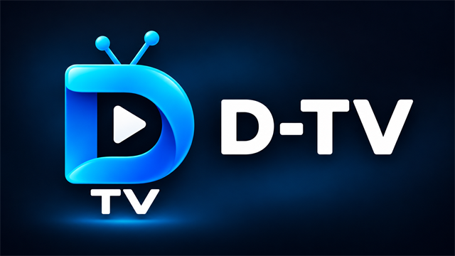
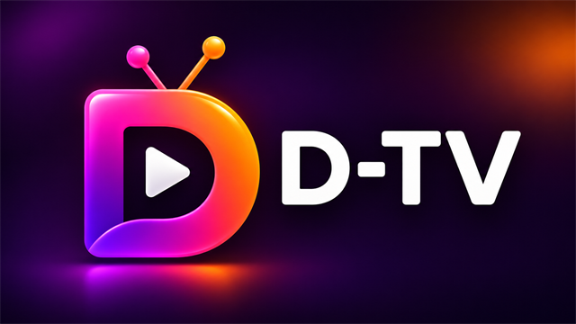
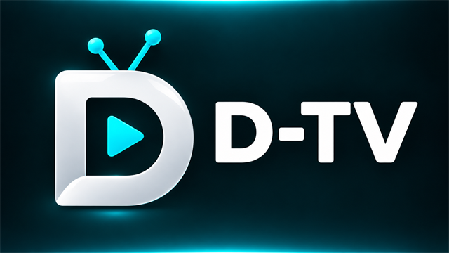
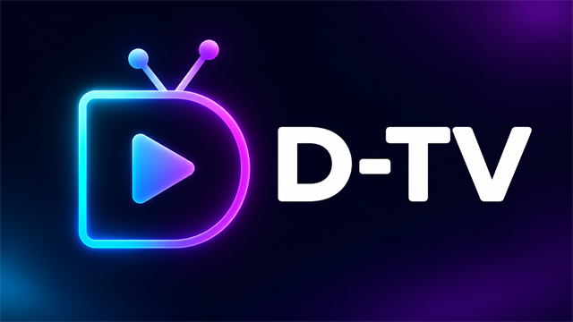
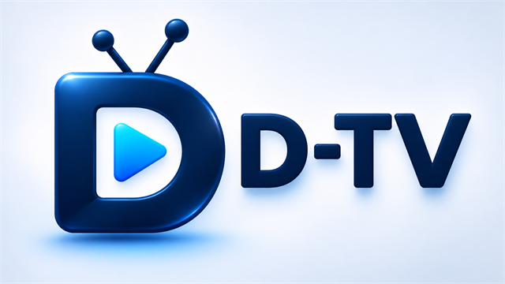
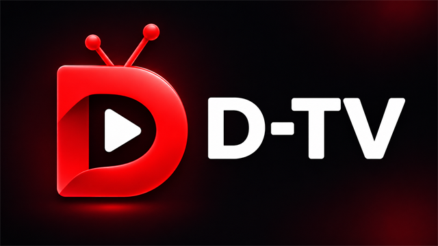

# D-TV

**A free, open-source IPTV player for Google TV, Android TV, Fire TV, phones and tablets.**

No subscription and no D-TV server. Connect a provider or playlist you already use.

[](https://github.com/bryjenko/dtv/actions/workflows/build.yml)
[](LICENSE)
[](https://github.com/bryjenko/dtv/releases/latest)

## What D-TV includes

- Live TV from Xtream Codes logins and M3U/M3U8 playlists, with an XMLTV guide
- Favourites, search, and controls to hide individual channels or whole channel groups
- Recordings to device storage, USB drives, or a NAS over SMB; reminders and series recording
- Movies and series with resume, profiles, and watch history
- A remote-friendly interface with adjustable sizing, language selection, and six launcher banner styles
- Encrypted phone-to-TV configuration backup using a six digit code

### Choose a launcher banner

Choose one of these six designs in **Settings → Display & Playback**. The selection also updates
the Android phone app icon and the logo shown in D-TV's navigation.

| Blue | Sunset | Ice |
| :---: | :---: | :---: |
|  |  |  |
| **Neon** | **Classic** | **Red** |
|  |  |  |

## Download

Get the latest signed APK from [GitHub Releases](https://github.com/bryjenko/dtv/releases/latest).
D-TV requires Android 8.0 or newer. GitHub Actions builds every release from its tagged source;
the build workflow and logs are public.

## Backup and restore

Scan the QR code on the TV with a phone, then follow the Backup or Restore page. The encrypted
configuration transfers directly over the local network. See [the backup guide](docs/BACKUP.md).

## Build from source

```bash
git clone https://github.com/bryjenko/dtv.git
cd dtv
./gradlew assembleDebug
```

You need JDK 17+ and the Android SDK (API 35). The debug APK is written to
`app/build/outputs/apk/debug/`.

## Independent maintenance

D-TV is an independently maintained project, with its own branding, releases, and build workflow.
It is based on [OpenTV](https://github.com/opentvproject/opentv) (last synced at OpenTV v0.11.8).
It is not configured to receive changes from another repository automatically.

## Licence

D-TV is licensed under [GPL-3.0-or-later](LICENSE). Existing copyright and license notices remain
with the source files.
